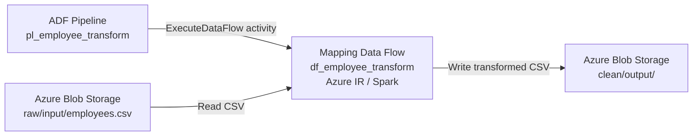
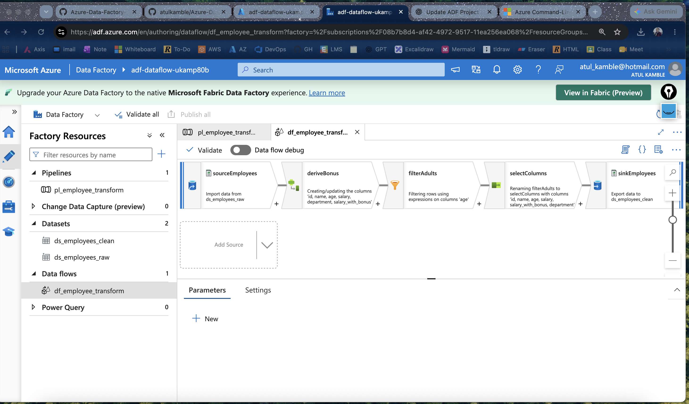

# Azure Data Factory Employee Data Transformation with Terraform

## Project Title

**Automated Azure Data Factory Mapping Data Flow Deployment and Employee CSV Transformation Using Terraform**

## Objectives

- Provision Azure resources using Terraform: resource group, Blob Storage, Data Factory, and managed identity permissions.
- Upload the sample employee CSV to the `raw/input/` Blob location.
- Deploy the Blob linked service, source and sink datasets, Mapping Data Flow, and pipeline from version-controlled JSON.
- Calculate `salary_with_bonus` as a 10% increase, filter employees with `age > 25`, and select the required columns.
- Execute the pipeline and validate the expected three-row CSV in `clean/output/`.
- Monitor execution and clean up lab resources when finished.

---

## 🏗️ Architecture Overview



**Transformation:** Source → Derived Column (`salary_with_bonus = round(salary * 1.10, 2)`) → Filter (`age > 25`) → Select → Sink.

**Expected output:** 3 records from 4 input records. Both Blob containers are in the same storage account. The ADF pipeline orchestrates the Data Flow; the Spark runtime reads and writes Blob data.

[Detailed architecture and sequence diagrams](docs/ARCHITECTURE.md) · [Azure deployment commands](docs/AZURE-DEPLOYMENT.md)

---

## Deploy and Run the Project

**Prerequisites:** Azure CLI, Terraform 1.6+, Azure subscription access, and permissions to create resources and assign RBAC roles. Clone the repository and run these commands from its root.

### 1. Sign in and select the subscription

```bash
az login
az account set --subscription "08b7b8d4-af42-4972-9517-11ea256ea068"
az account show --query "{name:name,id:id}" -o table
```

### 2. Deploy infrastructure and ADF artifacts

```bash
cd terraform
cp terraform.tfvars.example terraform.tfvars
terraform init
terraform fmt -check
terraform validate
terraform plan -out=tfplan
terraform apply tfplan
terraform output
```

The Terraform configuration uploads `sample-data/employees.csv` and creates the Blob containers, managed identity role assignment, linked service, datasets, Mapping Data Flow, and pipeline. **Verified 1 November 2026:** 13 resources deployed successfully in `centralindia`.

### 3. Run the pipeline

```bash
RG=$(terraform output -raw resource_group_name)
FACTORY=$(terraform output -raw data_factory_name)
STORAGE=$(terraform output -raw storage_account_name)

RUN_ID=$(az datafactory pipeline create-run \
  --resource-group "$RG" \
  --factory-name "$FACTORY" \
  --name pl_employee_transform \
  --query runId -o tsv)
echo "Pipeline run ID: $RUN_ID"
```

### 4. Check pipeline and activity status

```bash
az datafactory pipeline-run show \
  --resource-group "$RG" \
  --factory-name "$FACTORY" \
  --run-id "$RUN_ID" \
  --query "{status:status,message:message}" -o json

az datafactory activity-run query-by-pipeline-run \
  --resource-group "$RG" \
  --factory-name "$FACTORY" \
  --run-id "$RUN_ID" \
  --last-updated-after "2026-01-01T00:00:00Z" \
  --last-updated-before "2027-01-01T00:00:00Z" \
  --query "value[].{activity:activityName,status:status,error:error.message}" -o table
```

The pipeline may remain `InProgress` while ADF starts Spark compute. Check again until it reaches a terminal status. You can also inspect the run in **Azure Data Factory Studio → Monitor**.

### 5. Verify the transformed CSV

```bash
az storage blob list \
  --account-name "$STORAGE" \
  --container-name clean \
  --prefix output/ \
  --auth-mode login \
  -o table
```

Expected output: `clean/output/employees_clean.csv`, containing the three employees older than 25 and their 10% salary bonus. Your signed-in Azure identity must have Blob data read permissions for `--auth-mode login`; the Terraform role assignment grants access to the **Data Factory managed identity**, not automatically to your user.

### 6. Optional cleanup

```bash
terraform destroy
```

**Status:** Terraform infrastructure deployment succeeded. Pipeline execution and transformed output have **not yet been confirmed**. Mapping Data Flow execution incurs Azure compute charges. See [Terraform deployment details](terraform/README.md).

---

## 🧰 Services Used

* Azure Data Factory
* Azure Blob Storage
* Azure SQL Database (optional)
* Mapping Data Flow
* Integration Runtime

---

## 📁 Sample Dataset

Example CSV:

```csv
id,name,age,salary,department
1,Atul,28,50000,IT
2,Rahul,35,70000,HR
3,Neha,22,30000,IT
4,Ankit,40,90000,Finance
```

---

# ⚙️ Step-by-Step Implementation

## 🔹 Step 1: Create Azure Resources

* Create **Resource Group**
* Create:

  * Storage Account → Upload CSV file
  * Azure Data Factory
  * Azure SQL Database (optional)

---

## 🔹 Step 2: Create Linked Services

In ADF:

* Blob Storage → connect using access key
* SQL Database → connect using credentials

---

## 🔹 Step 3: Create Datasets

* Source Dataset → CSV from Blob
* Sink Dataset → SQL Table / Blob

---

## 🔹 Step 4: Create Mapping Data Flow

### 🔧 Transformations Used:

### 1️⃣ Source

* Select dataset (CSV)
* Enable schema import

---

### 2️⃣ Derived Column

Add new column:

```text
salary_with_bonus = salary * 1.1
```

---

### 3️⃣ Filter

Condition:

```text
age > 25
```

---

### 4️⃣ Select

* Choose required columns
* Rename columns if needed

---

### 5️⃣ Sink

* Load into SQL table or Blob

---

### Azure Data Factory Studio – Deployed Mapping Data Flow



*Screenshot captured 1 November 2026 in Azure Data Factory Studio. It shows the deployed visual transformation; pipeline execution is not yet verified.*

---

## 🔹 Step 5: Create Pipeline

* Add **Data Flow Activity**
* Select created Data Flow
* Debug → Publish → Trigger

---

## 🔹 Step 6: Trigger Pipeline

* Manual Trigger OR Scheduled Trigger

---

## 📊 Output Example

| id | name  | age | salary | salary_with_bonus | department |
| -- | ----- | --- | ------ | ----------------- | ---------- |
| 1  | Atul  | 28  | 50000  | 55000             | IT         |
| 2  | Rahul | 35  | 70000  | 77000             | HR         |
| 4  | Ankit | 40  | 90000  | 99000             | Finance    |

---

# 📌 Key Concepts (Exam-Oriented AZ-104 / AZ-305)

### 🔹 Mapping Data Flow

* Visual data transformation
* Runs on Spark cluster (auto-managed)

### 🔹 Integration Runtime

* Compute engine for ADF
* Types:

  * Azure IR
  * Self-hosted IR

### 🔹 Data Flow vs Pipeline

| Feature        | Pipeline      | Data Flow |
| -------------- | ------------- | --------- |
| Control Flow   | Yes           | No        |
| Transformation | Limited       | Advanced  |
| Compute        | Orchestration | Spark     |

---

# ⚡ Real-Time Use Cases

* Data cleaning before ML models
* ETL pipelines for data warehouse
* Log processing
* Batch data transformation

---

# 🚀 Best Practices

* Use **Debug mode** for testing
* Partition large datasets
* Use **parameterization**
* Monitor via **ADF Monitor tab**
* Use staging for large loads

---

# ⚠️ Common Issues & Fix

| Issue           | Fix                        |
| --------------- | -------------------------- |
| Data Flow slow  | Increase compute (DIUs)    |
| Schema mismatch | Import schema properly     |
| Pipeline fails  | Check activity output logs |

---


# 📌 Interview Questions (ADF Data Flow – Updated)

---

## 🔹 1. Difference between Data Flow and Copy Activity?

| Feature     | Data Flow                       | Copy Activity                |
| ----------- | ------------------------------- | ---------------------------- |
| Purpose     | Data Transformation (ETL logic) | Data Movement (Lift & Shift) |
| Compute     | Spark Cluster (ADF managed)     | Integration Runtime          |
| Use Case    | Complex transformations         | Simple copy (Blob → SQL)     |
| Performance | Slower (heavy compute)          | Faster (direct copy)         |
| UI          | Visual transformation designer  | Simple config                |

👉 **Short Answer:**

* Copy Activity = Move Data
* Data Flow = Transform Data

---

## 🔹 2. What is Integration Runtime (IR)?

👉 **Definition:**
Integration Runtime is the **compute infrastructure** used by Azure Data Factory to perform data movement and transformation.

### Types:

* **Azure IR** → Cloud-based (default)
* **Self-hosted IR** → On-premise data access
* **Azure-SSIS IR** → Run SSIS packages

👉 **Use Case:**

* Connect on-prem DB → Cloud
* Execute pipelines & copy activity

---

## 🔹 3. How does ADF scale?

👉 ADF scales automatically using **serverless architecture**:

* **Copy Activity:** Scales using parallel threads
* **Data Flow:** Uses auto-managed **Spark clusters**
* **DIU (Data Integration Units):** Controls performance
* **Parallel pipelines:** Multiple pipelines can run simultaneously

👉 **Key Point:**
ADF is **fully managed → no infra management required**

---

## 🔹 4. What is Debug mode in Data Flow?

👉 **Definition:**
Debug mode allows you to **test Data Flow transformations without running full pipeline**

### Features:

* Uses temporary Spark cluster
* Preview data at each transformation
* Faster testing & validation

👉 **Important:**

* Debug cluster runs → **cost is incurred**
* Must stop debug after use

---

# 🔥 Additional Important Questions (Must Know)

---

## 🔹 5. What is Mapping Data Flow?

* Visual transformation tool in ADF
* Runs on Apache Spark
* No-code / low-code ETL

---

## 🔹 6. What is the difference between Pipeline and Data Flow?

| Pipeline      | Data Flow       |
| ------------- | --------------- |
| Orchestration | Transformation  |
| Control Flow  | Data Processing |
| Lightweight   | Compute Heavy   |

---

## 🔹 7. What is Dataset in ADF?

👉 Dataset represents:

* Structure of data (schema)
* Location of data (Blob, SQL, etc.)

---

## 🔹 8. What is Linked Service?

👉 Linked Service = Connection to data source
Example:

* Blob Storage
* SQL Database

---

## 🔹 9. What is Trigger in ADF?

* Schedule pipeline execution
* Types:

  * Schedule Trigger
  * Tumbling Window
  * Event-based

---

## 🔹 10. What is DIU?

👉 **Data Integration Unit (DIU)** = Measure of compute power in ADF

* Higher DIU → Better performance
* Used in Copy Activity

---

## 🔹 11. What is Sink and Source?

* **Source:** Input data
* **Sink:** Output destination

---

## 🔹 12. What are common transformations in Data Flow?

* Filter
* Derived Column
* Join
* Aggregate
* Sort

---

# 🎯 Final Tip (Interview Ready)

👉 Always explain like this:

> “ADF is used for orchestration and ETL.
> Copy Activity handles data movement,
> while Data Flow handles transformation using Spark.”


---
