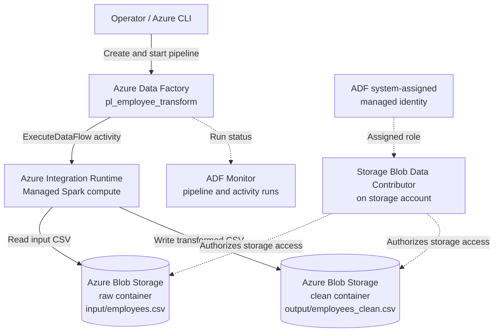
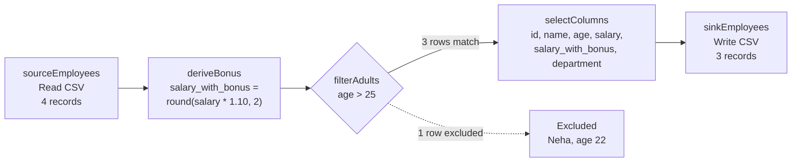
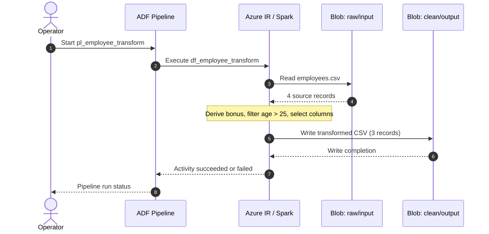

# Architecture and Data Flow Diagrams

These diagrams match the repository's **Blob-to-Blob** implementation. Azure SQL is an optional future extension, not part of the checked-in pipeline. Arrows distinguish orchestration commands from actual CSV data movement.

## 1. Azure deployment architecture

**Note:** Source and sink containers reside in the same Azure Storage account in this lab. ADF uses managed identity for authorization. The Integration Runtime runs the Spark-based mapping data flow; the pipeline orchestrates its execution.

## 2. Mapping Data Flow — actual transformation sequence

The filter does **not** create a separate rejection sink: excluded rows are dropped. The `selectColumns` stage retains six columns, and `sinkEmployees` writes the output under the clean container.

## 3. Execution sequence

## 4. Example data and expected output

| id | name | age | salary | salary_with_bonus | department | Outcome |
|---:|---|---:|---:|---:|---|---|
| 1 | Atul | 28 | 50000 | 55000 | IT | Included |
| 2 | Rahul | 35 | 70000 | 77000 | HR | Included |
| 3 | Neha | 22 | 30000 | 33000 | IT | Filtered out |
| 4 | Ankit | 40 | 90000 | 99000 | Finance | Included |

The excluded row is shown only to explain the transformation; it does not appear in the destination.

## 5. Scope and validation

- **Implemented in repository:** one Blob linked service, two delimited-text datasets, one Mapping Data Flow, and one pipeline containing an ExecuteDataFlow activity.
- **Not implemented:** Azure SQL sink, schedule trigger, rejection/quarantine output, or external orchestration services.
- **Requires Azure verification:** data flow script parsing, managed identity connection, sink file naming, pipeline execution, and actual output. Diagrams document the intended design, not a verified deployment.
- **Compute:** Mapping Data Flow uses Spark cores configured on the ExecuteDataFlow activity; Copy Activity DIUs are not applicable here.

See [deployment steps](AZURE-DEPLOYMENT.md).
