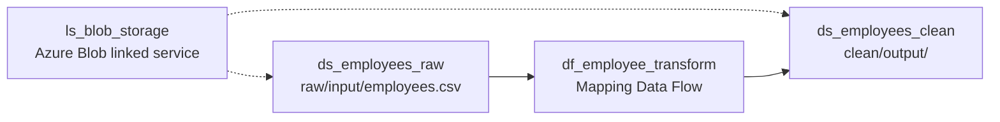

# Dataset configuration and validation

## Dataset relationship



## Source dataset: `ds_employees_raw`

- Dataset type: `DelimitedText`.
- Linked service: `ls_blob_storage`.
- Container: `raw`; folder: `input`; filename: `employees.csv`.
- CSV settings: comma delimiter, LF row delimiter, UTF-8, double-quote quoting, backslash escaping, header row enabled, empty string as null.
- Dataset schema: `id,name,age,salary,department`, represented as strings in the dataset metadata. **The Mapping Data Flow source projection** explicitly assigns integer/decimal types; don't confuse dataset schema metadata with Spark projection types.

## Sink dataset: `ds_employees_clean`

- Dataset type: `DelimitedText`.
- Linked service: `ls_blob_storage`.
- Container: `clean`; folder: `output`; **no fixed file name in the dataset**.
- Same CSV formatting settings as the source.
- Output columns: `id,name,age,salary,salary_with_bonus,department`.
- The Mapping Data Flow sink's `filePattern` / `partitionFileNames` settings determine the output filename. Check the actual generated blob name after execution.

## Deployment commands

From the repository root, after creating the linked service and Data Factory (see [deployment guide](AZURE-DEPLOYMENT.md)):

```bash
mkdir -p .deployment
jq '.properties' dataset/ds_employees_raw.json > .deployment/raw-properties.json
jq '.properties' dataset/ds_employees_clean.json > .deployment/clean-properties.json

az datafactory dataset create \
  --resource-group "$RG" --factory-name "$FACTORY" \
  --dataset-name ds_employees_raw \
  --properties @.deployment/raw-properties.json

az datafactory dataset create \
  --resource-group "$RG" --factory-name "$FACTORY" \
  --dataset-name ds_employees_clean \
  --properties @.deployment/clean-properties.json

az datafactory dataset show -g "$RG" --factory-name "$FACTORY" --dataset-name ds_employees_raw -o json
az datafactory dataset show -g "$RG" --factory-name "$FACTORY" --dataset-name ds_employees_clean -o json
```

## Review checklist

1. Confirm source and sink datasets reference the existing linked service.
2. Test the linked service's managed identity access in ADF Studio.
3. Confirm `raw/input/employees.csv` exists and its header matches the schema.
4. Import/inspect the Data Flow source projection (integer id/age and decimal salary).
5. Inspect the sink settings for file naming, header output and output directory.
6. Run the pipeline and verify three rows in the clean container.

**Status:** JSON files were reviewed for consistency with the repository and updated; no live Azure deployment or ADF Studio validation was performed.
